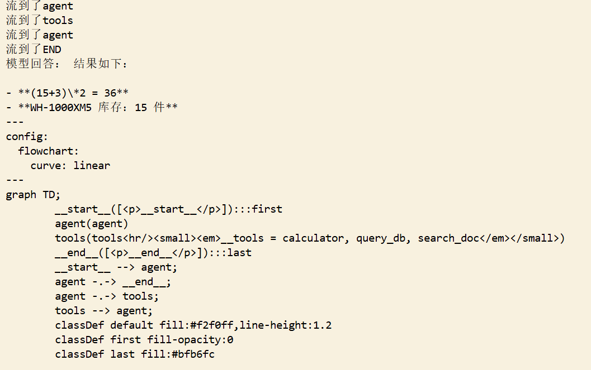

1.**概述**：一个基于 LangGraph 的多工具 Agent，用「状态图 + 条件边」实现 ReAct 循环，自动调度「计算 + SQL 查库 + 文档检索」三个工具回答跨工具问题，支持 Human-in-the-loop（人工审批），后端接 DeepSeek API。

2.**功能清单**：多工具调度 / ReAct 循环（状态图+条件边）/ 三工具（计算器、SQLite 查库存、复用项目2的 RAG 检索）/ Human-in-the-loop

3.**技术栈**：LangGraph · LangChain · DeepSeek API · Function Calling · SQLite · python-dotenv

4.**架构图**：
```
graph TD;
        __start__([<p>__start__</p>]):::first
        agent(agent)
        tools(tools<hr/><small><em>__tools = calculator, query_db, search_doc</em></small>)
        __end__([<p>__end__</p>]):::last
        __start__ --> agent;
        agent -.-> __end__;
        agent -.-> tools;
        tools --> agent;
        classDef default fill:#f2f0ff,line-height:1.2
        classDef first fill-opacity:0
        classDef last fill:#bfb6fc
```

5.**截图**

6.**快速开始**：
pip install -r requirements.txt

7.**附带（MCP Demo）**：`mcp_server.py` 用 FastMCP 暴露 4 个工具（add / get_now / echo / search_doc，search_doc 复用项目 2 的 RAG 检索），`mcp_client.py` 走 stdio 跨进程调用。运行 `python mcp_client.py`（客户端会自己拉起服务端）。注：search_doc 依赖同级的 project2-rag-qa 仓库。